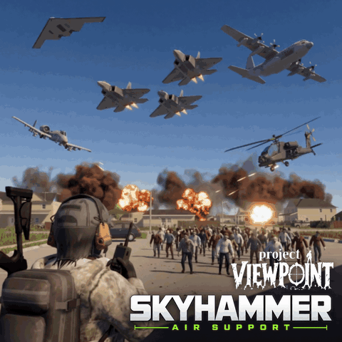
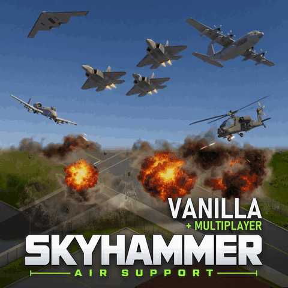
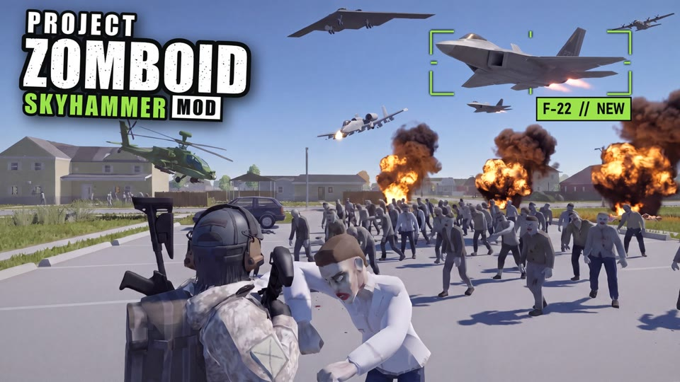
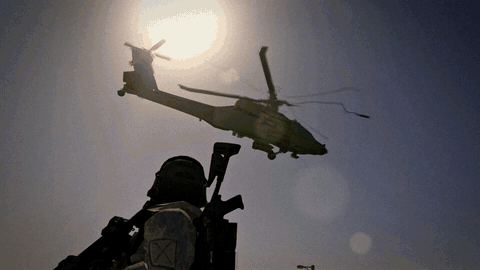
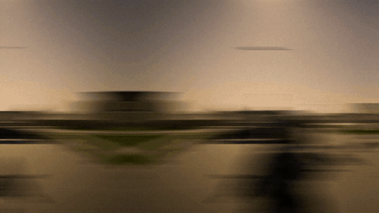
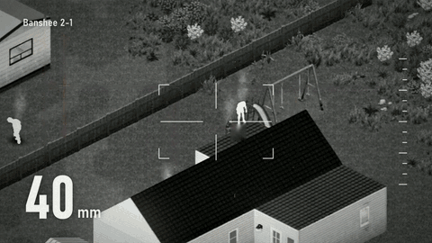
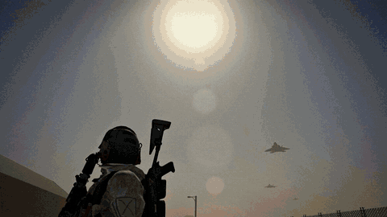
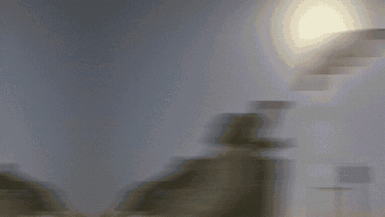

<table>
<tr>
<td width="50%"></td>
<td width="50%"></td>
</tr>
<tr>
<td align="center"><b>Viewpoint edition</b>: first and third person, aircraft in 3D</td>
<td align="center"><b>Vanilla edition</b>: the vanilla view, multiplayer</td>
</tr>
</table>

# Skyhammer Air Support

**The sky has your back.** A Project Zomboid Build 42 mod: earn a radio, then call an AH-64 Apache, an A-10 Warthog, an AC-130 gunship, a flight of F-22 Raptors and a B-2 bomber onto the infected. Every call is voiced and subtitled, targets are marked on a thermal sensor map, and the aircraft fly overhead.

This repository holds the sources of the whole Skyhammer series: what ships on the Steam Workshop and what builds it.

 
<a href="https://www.youtube.com/watch?v=Lmj2kkp3a-s">Watch the two-minute showcase on YouTube</a>

## Get it on the Workshop

| Mod | What it is | Workshop |
|---|---|---|
| Skyhammer Air Support | The main mod, Viewpoint edition. Single player. Needs ZombieBuddy and Viewpoint. | [3813483790](https://steamcommunity.com/sharedfiles/filedetails/?id=3813483790) |
| Skyhammer Air Support: Vanilla Edition | The same air support with no other mod; aircraft show as ground shadows. Multiplayer (experimental). | [3813973682](https://steamcommunity.com/sharedfiles/filedetails/?id=3813973682) |
| THOR | Add-on: an orbital tungsten strike. | [3816298691](https://steamcommunity.com/sharedfiles/filedetails/?id=3816298691) |
| ODIN | Add-on: a giant robot dropped from orbit. | [3815899202](https://steamcommunity.com/sharedfiles/filedetails/?id=3815899202) |
| Wraith Team | Add-on: five operators fight beside you for two minutes. Needs Bandits. | [3813821529](https://steamcommunity.com/sharedfiles/filedetails/?id=3813821529) |
| Wraith Operator | An occupation: start as a Wraith Team operator. | [3813870006](https://steamcommunity.com/sharedfiles/filedetails/?id=3813870006) |

Build 42.21 or later (tested on 42.22). Enable only one of the two main editions.

## The aircraft

<table>
<tr>
<td width="50%" valign="top"> 
<b>Hellhound One-One, AH-64 Apache.</b> Escorts you with its 30mm, fires rocket salvos into big groups and drops illumination flares on a marked spot.</td>
<td width="50%" valign="top"> 
<b>Valkyrie Two-Six, A-10.</b> Mark one point and it strafes a 40-tile line through it with the GAU-8. On the same sortie, mark another and a 40-tile strip goes up in napalm.</td>
</tr>
<tr>
<td width="50%" valign="top"> 
<b>Banshee Two-One, AC-130.</b> Its 40mm fires on the infected around you and its 105mm drops shells where you mark. Or take the gunner seat yourself: 25mm, 40mm and 105mm in a thermal view.</td>
<td width="50%" valign="top"> 
<b>Raven One-One, F-22.</b> Ten Raptors streak over at Mach speed, 0.4 seconds apart, and drop 20 heavy bombs on a 70 by 40 tile strip. Sonic booms included.</td>
</tr>
<tr>
<td width="50%" valign="top"> 
<b>Titan Zero-One, B-2.</b> Carpets the area you mark with heavy bombs that go through roofs, up to three floors.</td>
<td width="50%" valign="top"> 
<b>Tactical nuke.</b> The B-2's other load. Mark a spot 60 to 300 tiles away; fifteen seconds later every infected within 140 tiles is gone, and ground zero stays radioactive for days.</td>
</tr>
</table>

## How it plays

1. **Earn the radio.** A new game starts with a quest: build a relay (a wall satellite dish, a military ham radio within 6 tiles and generator power), then call Aegis Control. Don't want the quest? Pick "Any two-way radio" in the sandbox.
2. **Call it in.** Turn on the air support radio, press **K** (or right-click the radio) to open the terminal, pick an aircraft and press **CALL**.
3. **Mark the target** on the sensor map or straight in the game view (**EYES-ON**) for the 105mm, the A-10, the F-22 and the B-2.

**Killstreak mode** swaps cooldowns for points: every infected you kill yourself is a point, and points call the aircraft.

**Mod Options** set arrival times, cooldowns, ammo, ranges and volumes, plus optional craters that stay on the map, strikes that fell trees, blasts that reach indoors, player protection and vehicle damage. Each aircraft can be turned off in the sandbox.

## What is in this repository

| Folder | Mod |
|---|---|
| `SkyhammerAirSupport` | Skyhammer Air Support (Viewpoint edition) |
| `SkyhammerThor` | THOR add-on |
| `SkyhammerJaeger` | ODIN add-on |
| `SkyhammerWraith` | Wraith Team add-on |
| `SkyhammerWraithOperator` | Wraith Operator occupation |

- Each mod's `42` folder is exactly what ships on the Workshop; `common` holds its credits and licence notes.
- `source` holds what builds it: the radio lines and translations (`lines.json`, `ui_*.json`, `build.js`), the Java code for the 3D aircraft (`source/java`), the CC BY aircraft models and their conversion scripts (`source/models_ccby`), art and sound sources, and the Workshop page texts and upload script (`source/workshop_v2`).
- The Vanilla edition is built from the main mod by `SkyhammerAirSupport/source/build_vanilla.js`.
- Lua checks are in `SkyhammerAirSupport/source/tests`: `sim_*.py` run on Lua 5.1 through lupa, and `kahlua/*.cmd` run on the game's own Kahlua. Their runners are not included.

## Use

- **Please do not re-upload these mods**, whole or in part, to the Workshop or anywhere else.
- **Compatibility patches and add-ons are welcome.** Depend on the Workshop item instead of copying its files. Questions and bug reports go to the Discussions tab on the Workshop page.
- Unless a file says otherwise, all rights are reserved. The Java code for the 3D aircraft, the UH-60 and the napalm canister geometry are MIT (`SkyhammerAirSupport/common/LICENSE-aircraft.txt`). The aircraft models keep their own CC BY 4.0 licence (below).

## Credits

- Inspired by [Dark Zone Fire Support](https://steamcommunity.com/sharedfiles/filedetails/?id=3791733763) (Raven Bloodqueen) and [Shadowcopter](https://steamcommunity.com/sharedfiles/filedetails/?id=3787424467) (qwerto).
- Aircraft models, [CC BY 4.0](https://creativecommons.org/licenses/by/4.0/), changed for this mod (converted, fewer faces, gear and cockpit insides removed, colours baked): ["Ah64"](https://sketchfab.com/3d-models/ah64-3bc9b90cc97a40a6bfc13237329ce51b), ["A10"](https://sketchfab.com/3d-models/a10-8fec9884fe07476bbcaa34d9521726c4), ["B2"](https://sketchfab.com/3d-models/b2-a9be2ca923aa44809194613209810d06) and ["F22"](https://sketchfab.com/3d-models/f22-01b4128f65094d899e10c659e60f0858) by manilov.ap; ["Lockheed AC-130 Hercules"](https://sketchfab.com/3d-models/lockheed-ac-130-hercules-361991c9874d4680931b3e0d23500e43) by helijah.
- Sounds: rubberduck's "25 CC0 bang / firework SFX" (CC0), BigSoundBank (CC0), Freesound recordings by FreqMan and qubodup (CC0), Celestial SFX.
- Voices: Chatterbox, Piper and Kokoro TTS; the ODIN add-on's pilot is VOICEVOX:青山龍星.
- The AC-130 gunner seat's entry videos were made with Google Gemini. The gunner seat uses material from Call of Duty: Modern Warfare; all rights to it belong to Activision Publishing, Inc. and the respective rights holders.
- Artwork: AI-generated.
- Full list with links: `SkyhammerAirSupport/common/CREDITS.txt`.
- Project Zomboid, Viewpoint, ZombieBuddy and Bandits belong to their authors and are not included here. This project is not affiliated with Activision or Call of Duty.

## 한국어 소개

무전으로 아파치, A-10, AC-130, F-22 편대, B-2 폭격기를 불러 좀비를 쓸어버리는 프로젝트 좀보이드 B42 모드입니다. 모든 무전은 음성과 자막이 나오고, 열화상 센서 지도에 목표를 찍으면 기체가 머리 위로 날아옵니다. 뷰포인트판은 기체가 3D로 보이고(싱글), 바닐라판은 다른 모드 없이 돌아가며 멀티플레이를 지원합니다. 설치는 위의 창작마당 링크에서 하시면 됩니다. 이 저장소의 파일을 다시 올리는 것은 금지이고, 호환 패치와 애드온은 환영합니다.
